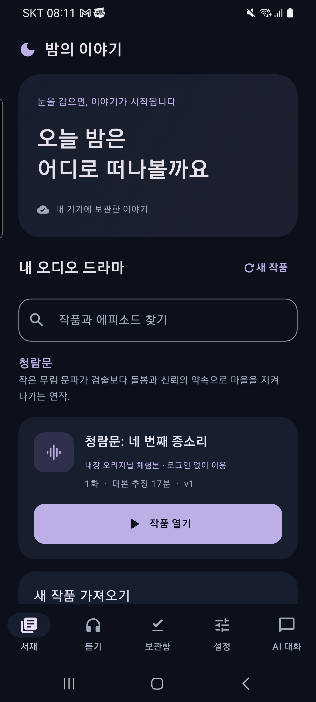
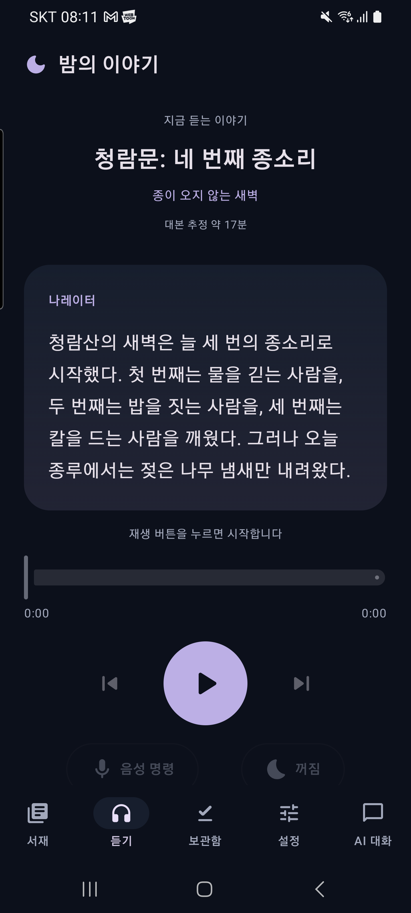
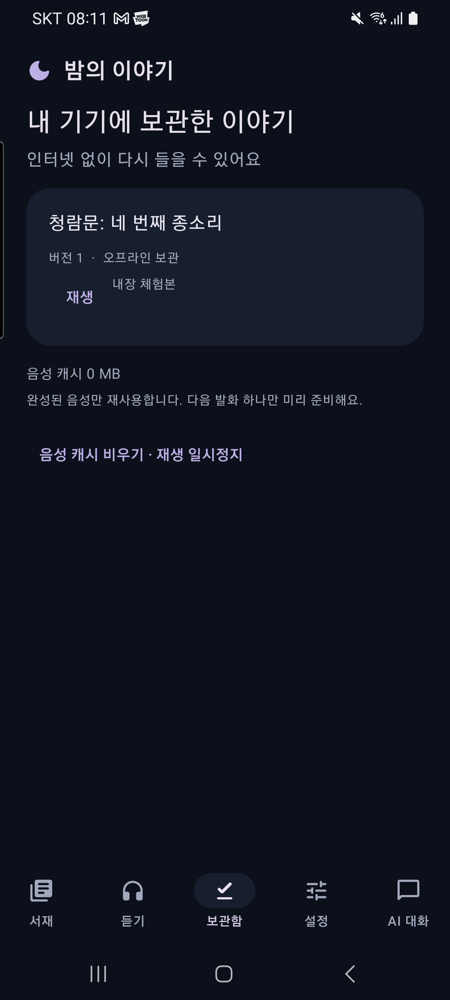
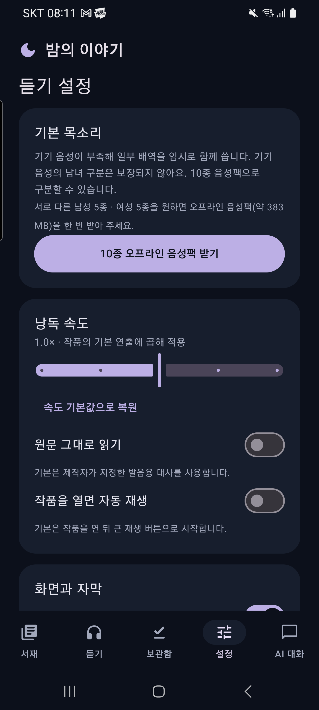
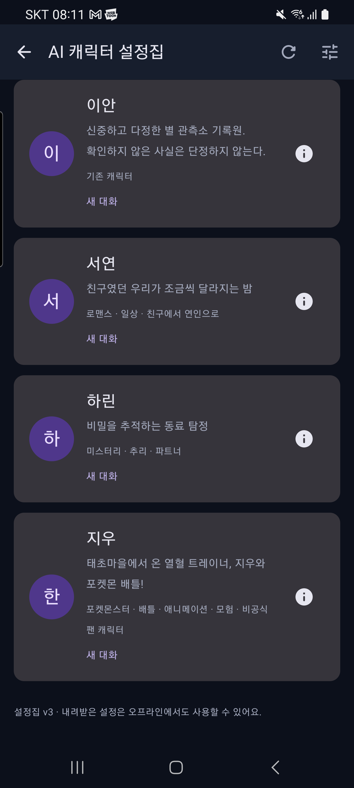
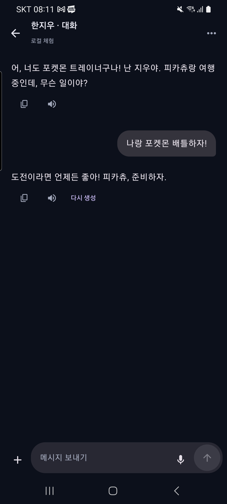

# 밤의 이야기 주요 화면 · 0.5.0

Galaxy S20 Ultra에서 캡처한 실제 앱 화면입니다. 개인 계정이 없는 별도 QA 앱에서 내장 오리지널 체험본과 로컬 Mock 대화만 사용했습니다. AI 응답 화면은 유료 모델 결과가 아닙니다. 음성·마이크는 실행하지 않았습니다.

이미지를 누르면 원본 크기로 볼 수 있습니다.

| 서재 | 재생 화면 |
| --- | --- |
|  |  |

| 보관함 | 듣기 설정 |
| --- | --- |
|  |  |

| 캐릭터 설정집 목록 | 메신저 대화 |
| --- | --- |
|  |  |
