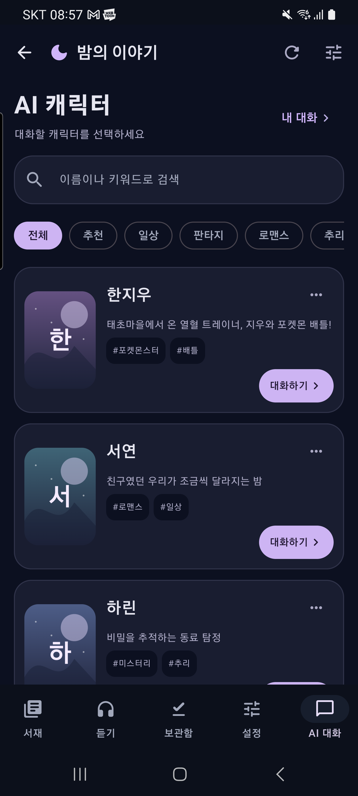
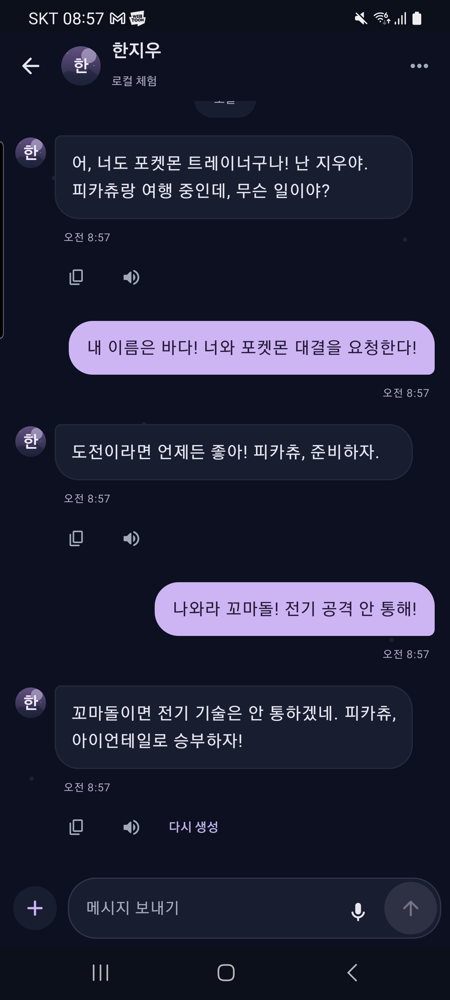

# 밤의 이야기 · 0.6.0 새 AI 대화 화면

실제 Galaxy S20 Ultra의 Compose 화면입니다. 최신 시안을 참고해 목록·카드·검색·필터와 메신저를 구현했습니다.

| 캐릭터 목록 | 지우와 왕복 대화 |
| --- | --- |
|  |  |

개인 계정 없는 QA 앱에서 캡처했습니다. 대화는 로컬 Mock 응답이며 유료 모델 결과가 아닙니다.
시안의 원작풍 인물 컷을 복제하지 않고 자체 추상 아바타를 사용했습니다.
음성·마이크는 실행하지 않았고 기존 실제 앱의 인증·서재·대화는 보존했습니다.

[최신 APK 받기](https://github.com/1210guswls/ai-drama-player-apk/releases/latest/download/nightstory-latest.apk)
